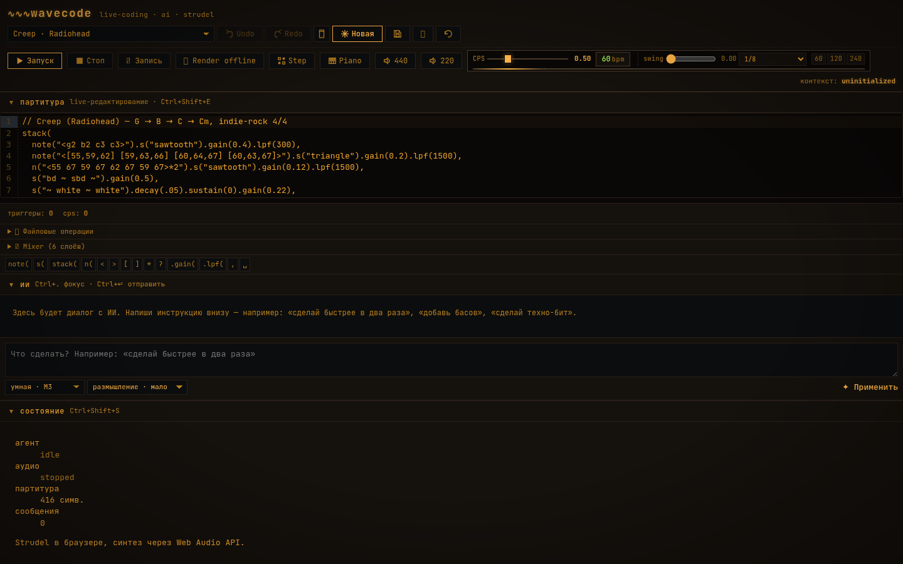

# wavecode

> **Live-coding музыка в браузере, с AI-агентом.**
> Пишешь score на Strudel mini-notation — агент по запросу правит, играет через Web Audio API.
> Pure-frontend SPA, без backend, без сервера.
>
> 🇬🇧 **English version:** [README.en.md](README.en.md) · 🇷🇺 Этот файл — основной

<p align="center">
  <a href="LICENSE"></a>
  <a href=".github/workflows/ci.yml"></a>
  <a href="https://wavecode.kosov.online/"></a>
  <a href="https://github.com/11111000000/wavecode"></a>
</p>

<p align="center">
  
</p>

---

## ▶ Попробовать

* **Live demo:** <https://wavecode.kosov.online/> (также доступно через Tailscale: <https://wavecode.tail347ae6.ts.net/>)
* **Стабильный билд:** деплоится автоматически в `master` → [см. CI/CD](docs/ARCHITECTURE.md)
* **PWA:** устанавливается как standalone-приложение (Chrome / Edge / Safari iOS 16.4+)

> **Первый запуск:** открой `#/app` (мимо landing), подожди ~5 секунд пока прогрузятся Strudel-сэмплы из ServiceWorker-кеша. Бейдж «Загружено N/M семплов» в верхней панели показывает прогресс. Звук включается только по клику ▶ (browser autoplay policy).

---

## Что это такое

**wavecode** — браузерный AI-агент для live-coding музыки. Score-файл (JS-код со Strudel mini-notation) редактируют **оба**: пользователь и LLM. Strudel runtime в main thread пересчитывает паттерны и играет через Web Audio API. Никаких серверов, кроме LLM-прокси (`llm.kosov.online`).

```text
┌────────────────────────────────────────────────────────┐
│ Browser (single SPA)                                   │
│                                                        │
│  ┌──────────┐  ┌──────────┐  ┌────────────────────┐   │
│  │ Solid UI │←→│ Effect   │  │  Main thread        │   │
│  │ + CM6    │  │ Layer DI │  │  Strudel runtime    │   │
│  └────┬─────┘  └────┬─────┘  │  @strudel/webaudio  │   │
│       │             │        └─────────┬──────────┘   │
│       │             │                  │              │
│       │             ▼                  ▼              │
│       │      LLMClient ──► llm.kosov.online   Web Audio API
│       │             │                  │              │
│       ▼             ▼                  ▼              │
│   IndexedDB  (score + messages)    speakers           │
└────────────────────────────────────────────────────────┘
```

**Стек:** TypeScript (strict) · Solid.js 1.8 · Effect-TS 3.x · CodeMirror 6 · `@strudel/webaudio` · `idb-keyval` · `fetch` к OpenAI-compatible LLM API. Тесты: vitest + Playwright.

**Подробнее:** [docs/ARCHITECTURE.md](docs/ARCHITECTURE.md) — 4 слоя (domain / application / infrastructure / presentation), Effect-Layer DI, почему не React/Monaco/Tidal+SuperDirt, как работает Strudel в main thread, agent loop, tool-calling.

---

## Quick start

Требования: **Node.js ≥ 20.10** (для `--experimental-strip-types` в validate:presets) и **pnpm** (`npm install -g pnpm`).

```sh
git clone https://github.com/11111000000/wavecode.git
cd wavecode/ui
npm install          # ~3 минуты на cold cache
cp .env.example .env.local
# отредактируй .env.local: VITE_LLM_PROXY_URL + VITE_LLM_PROXY_KEY
npm run dev          # http://localhost:5173/
```

### Проверка качества перед коммитом

```sh
cd ui
npm run typecheck           # tsc --noEmit
npm run test:run            # vitest (unit, 78 файлов, ~5 сек warm)
npm run lint:no-console      # проверяет domain/application на console.*
npm run validate:presets    # синтаксический smoke test всех BUILTIN_PRESETS
```

Или одной командой из корня: `bash scripts/pre-commit` (после `npm run precommit:install` для установки git-hook).

### Production-билд

```sh
cd ui
npm run build               # → ui/dist/
```

`ui/dist/` — статический SPA, готов к деплою на любой static-host (Vercel, Cloudflare Pages, GitHub Pages, nginx). Подробности деплоя — [bin/deploy.sh](bin/deploy.sh) и [docs/ARCHITECTURE.md § Deployment](docs/ARCHITECTURE.md).

---

## Возможности

- 🎵 **Strudel mini-notation** — 15 встроенных пресетов (Creep, EDM 4-on-floor, Hip-hop boom-bap, Jazz ii-V-I, Ambient drone, Bossa Nova, Trap Atlanta, Reggaetón, Step Grid demo, Piano ballad, 808 classic, Analog bass, 808 king, Retro lead, Toms funk) + свои через UI
- 🤖 **AI-агент** — multi-turn чат, tool-calling (`edit_score`, `eval_snippet`, `undo_score`, `read_score`), 2 модели (smart / fast)
- 🎹 **Piano keyboard** с WebMIDI — полифония, параллельная запись, sustain pedal
- 🥁 **Step sequencer** — grid-редактор (view/sketch/edit modes), live eval при правке score
- 🎚️ **Track mixer** — mute / solo / gain per track, live updates без перезапуска
- 🎙️ **Audio recording** — экспорт в WAV, счётчик тактов
- 🌐 **URL sharing** — `?s=…` кодирует весь score + messages, восстанавливается в новой сессии
- 📡 **PWA** — offline-готов, Workbox auto-update, отдельный кеш для Strudel-vendor
- ⌨️ **Hotkeys** — `Ctrl/⌘+\`` toggle Console, `Ctrl/⌘+Z/Y` undo/redo, focus AI/score
- 🔍 **Console UX** — bottom-sheet с тремя вкладками (Errors / All / By source), throttle 5/1s, IDB-персистентность последних 100 ошибок, ring buffer 500 записей
- 🔗 **URL state** — `#/`, `#/app`, `#/admin` (debug inspector)
- 🌍 **i18n** — README на русском (этот файл) и [английском](README.en.md)

---

## Архитектурные решения

Полная traceability — каждое решение зафиксировано как YAML в `decisions/` по схеме **math-coding 3.3** (см. [AGENTS.md § math-coding](AGENTS.md)). 97 решений покрывают всё: от выбора стека до throttle log-источника.

**Базовые 16** (см. [docs/ARCHITECTURE.md](docs/ARCHITECTURE.md) для деталей):

<!-- BEGIN decisions-table -->
| Решение | Статус | Резюме |
|---|---|---|
| `console-ux-polish` | active | Three additive polishes to the Phase-1 console UX (`math/wavecode-debug-console`) land without restructuring it: |
| `wavecode-codemirror-6` | draft | Редактор score в wavecode — CodeMirror 6 с кастомным расширением для Strudel mini-notation (highlight + completions). |
| `wavecode-debug-console` | active | Three observable UI surfaces share one log backend (`logger` from `math/wavecode-log-pipeline`): |
| `wavecode-effect-ts-architecture` | draft | Архитектурный рантайм wavecode — Effect-TS (3.x) с 4 слоями (domain, application, infrastructure, presentation) и Dependency Injection через |
| `wavecode-llm-litellm-proxy` | draft | LLM-клиент wavecode подключается к https://llm.kosov.online/v1 через @ai-sdk/openai-compatible; аутентификация — per-app Bearer-токен |
| `wavecode-log-pipeline` | active | The log surface in wavecode is split into three pure pieces so the console UIs (ConsoleButton / ConsoleSheet / Toast) can read from a |
| `wavecode-logger-enhancements` | active | Three additive enhancements land on top of `math/wavecode-log-pipeline`'s L1 ring buffer without restructuring it: 1. **`fatal` level** — adds a new highest severity that promotes auto-popup … |
| `wavecode-piano-polyphony` | active | `PianoKeyboard` plays ONE note at a time. That was fine for tap-on / tap-off, but the moment a user holds two keys (chord) — or WebMIDI delivers a 3-note chord from a controller — the late… |
| `wavecode-preset-decode-race` | active | Two independent correctness defects collapse into "no sound" once one is fixed and the surface becomes audible: |
| `wavecode-quality-tooling` | active | Two invariants are now machine-enforced on every `git commit`: 1. **Layering invariant**: `console.*` calls are forbidden in `ui/src/domain/**` and `ui/src/application/**` (ESLint `no-console… |
| `wavecode-scope` | draft | wavecode — чистофронтовый браузерный SPA для live-coding музыки с AI-агентом; не имеет серверных компонентов и не зависит от `~/Projects/Composer/`. |
| `wavecode-stack-performance` | draft | UI-слой wavecode использует Solid.js 1.8 вместо React для достижения максимальной производительности и минимального потребления ресурсов (fine-grained reactivity, ~7 KB runtime vs ~45 KB у R… |
| `wavecode-static-spa-deployment` | draft | wavecode деплоится как статический SPA: `pnpm build` → `ui/dist/` → любой static-host (Vercel, Cloudflare Pages, GitHub Pages, nginx). Без Nix-выходов, без контейнеризации, без серверного runtime… |
| `wavecode-strict-layering` | draft | Структурная целостность wavecode обеспечивается ESLint (flat config, v9) с правилом `no-restricted-imports` per-layer: domain не может импортировать solid-js / @strudel/* / idb-keyval, application — solid-js / @strudel / @ai-sdk / idb-keyval, … |
| `wavecode-strudel-in-browser` | active | Аудио в wavecode рендерится в браузере через `@strudel/core` + `@strudel/webaudio` (webaudioRepl + evaluate), без серверного TidalCycles+SuperDirt+Icecast. Паттерн-eval в main thread (≤10 мс на типичный snippet), W… |
| `wavecode-test-strategy` | draft | Тестовая стратегия wavecode — пирамида: много unit-тестов на domain и application (vitest, без моков), умеренно на infrastructure (vitest с моками Layer), немного e2e на Playwright для critical user-… |
<!-- END decisions-table -->

> **Полный список (97 решений):** `ls decisions/*.yaml` или `python3 scripts/build-readme-decisions.py`. О состояниях `draft`/`active` — см. [math-coding AGENTS.md](../math-coding/AGENTS.md): в 3.3 `state: active` присваивается явно, мигрированные v1.0 пакеты остаются `draft` до следующей ревизии. Это **не означает, что они не действуют** — все они применены в коде и подтверждены attestations.

---

## Качество кода

| Метрика | Значение | Где |
|---|---|---|
| TypeScript strict | `strict: true` + `noUncheckedIndexedAccess` + `exactOptionalPropertyTypes` + `verbatimModuleSyntax` | `ui/tsconfig.json` |
| ESLint per-layer | `no-restricted-imports` для domain / application / infrastructure / presentation | `ui/eslint.config.js` |
| `no-console` в domain/application | enforced lint rule | `ui/eslint.config.js:47,76` |
| Unit-тесты | 78 файлов vitest, ~5 сек warm | `ui/src/**/*.test.{ts,tsx}` |
| E2E тесты | 19 файлов playwright | `ui/tests/e2e/` |
| Pre-commit hook | typecheck + vitest + lint:no-console + validate:presets | `scripts/pre-commit` |
| CI | GitHub Actions: typecheck + vitest + lint + build | `.github/workflows/ci.yml` |
| Deployment CI | GitVerse Actions → SSH на angara-1 | `.gitverse/workflows/deploy.yml` |

**Layered architecture:** `ui/src/{domain,application,infrastructure,presentation}/` — каждый слой имеет явный контракт импортов, enforced eslint'ом. Domain — pure functions (без `fetch`/`AudioContext`/`solid-js`), application — Effect-typed use-cases, infrastructure — реализация `LLMClient`/`AudioEngine`/`Repo`, presentation — Solid-компоненты.

**Не полагаемся на:** React, Monaco Editor, Tidal+SuperDirt+Icecast, backend-сервисы, Nix outputs, Docker. Причины — в [docs/ARCHITECTURE.md](docs/ARCHITECTURE.md) и `decisions/wavecode-*.yaml`.

---

## Структура репозитория

```
wavecode/
├── README.md              этот файл (RU)
├── README.en.md           English version
├── AGENTS.md              протокол для AI-агентов (math-coding, git)
├── LICENSE                Apache-2.0
├── NOTICE                 third-party attributions
├── CONTRIBUTING.md        как контрибутить
├── CHANGELOG.md           история релизов
├── SECURITY.md            политика уязвимостей
├── .github/               GitHub-specific: workflows, issue/PR templates, CODEOWNERS
├── .gitverse/             GitVerse Actions workflows (deploy, math-coding gate)
├── bin/                   deploy.sh, check-llm-key.sh
├── decisions/             97 архитектурных решений (math-coding 3.3 schema)
├── attestations/          evidence store для math-coding self-check
├── schemas/               JSON-schema для math-coding 3.3
├── scripts/               утилиты: pre-commit, validate:presets, build-readme-decisions
├── docs/                  ARCHITECTURE.md, design.md, PLAN.md (internal)
└── ui/                    браузерный SPA
    ├── ARCHITECTURE.md    устаревший дубликат docs/ARCHITECTURE.md (transitional, удалить после v0.1.0)
    ├── package.json
    ├── tsconfig.json
    ├── eslint.config.js
    ├── vite.config.ts
    ├── playwright.config.ts
    └── src/
        ├── domain/        чистые типы, схемы, функции
        ├── application/   use-cases: llmEdit, editScore, evalWithTransport
        ├── infrastructure/ llm/, audio/, log/, repo/, haptics, composition
        └── presentation/  Solid-компоненты, state, panels
```

---

## Связь с Composer

**Никакой.** [`Composer`](https://github.com/11111000000/Composer) — отдельный backend-проект в другом треде разработки. wavecode не импортирует его flake, не использует его API, не имеет серверных компонентов. Это явно зафиксировано в [decisions/wavecode-scope.yaml](decisions/wavecode-scope.yaml).

---

## Контрибьютинг

См. [CONTRIBUTING.md](CONTRIBUTING.md) — короткий flow:

1. **Fork** → branch `feat/<slug>` / `fix/<slug>` / `docs/<slug>` / `refactor/<slug>`
2. **Перед коммитом:** `bash scripts/pre-commit` (или `npm run precommit:install` для автоустановки git-hook)
3. **Каждое архитектурное решение** — файл в `decisions/<id>.yaml` по схеме math-coding 3.3
4. **PR** — описать *что* и *почему*, а не *как*. CI гоняет typecheck + vitest + lint.

Issue templates: [bug report](.github/ISSUE_TEMPLATE/bug.yml) · [feature request](.github/ISSUE_TEMPLATE/feature.yml).

## Лицензия

[Apache License 2.0](LICENSE) — Copyright © 2026 Petr Kosov и контрибьюторы. Полный текст — [LICENSE](LICENSE). Third-party attributions — [NOTICE](NOTICE).

## Контакты

- **Live demo:** <https://wavecode.kosov.online/>
- **Tailscale:** <https://wavecode.tail347ae6.ts.net/>
- **Issues:** [github.com/11111000000/wavecode/issues](https://github.com/11111000000/wavecode/issues)
- **GitVerse mirror:** [gitverse.ru/b11111000000/wavecode](https://gitverse.ru/b11111000000/wavecode) (canonical)

---

<p align="center">
  <sub>README.md (RU) · <a href="README.en.md">README.en.md (EN)</a> · <a href="CHANGELOG.md">CHANGELOG</a> · <a href="CONTRIBUTING.md">CONTRIBUTING</a> · <a href="docs/ARCHITECTURE.md">ARCHITECTURE</a></sub>
</p>
